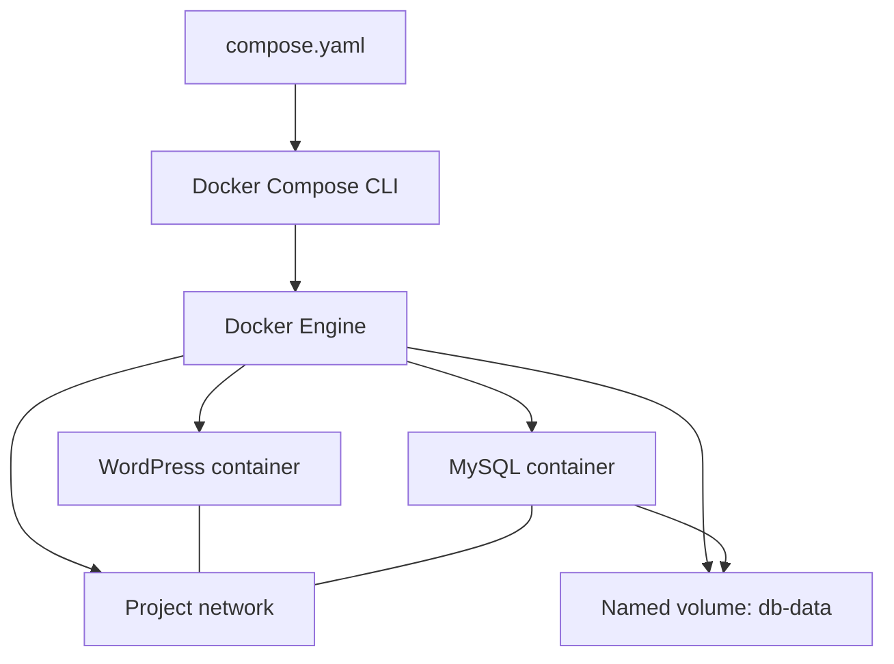
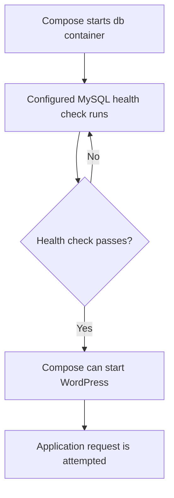
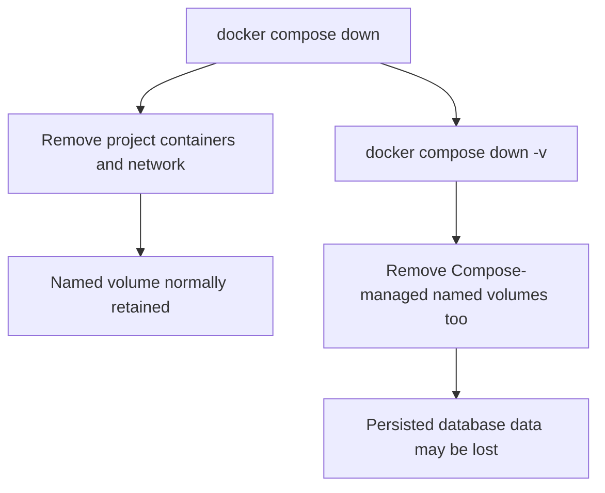

# Lesson 104 — Docker Compose Architecture

## Compose Resource Model

The Compose file describes the desired services and resources. The Compose CLI coordinates their lifecycle through the Docker Engine.

## WordPress and MySQL Communication

- The browser uses the published host port `127.0.0.1:8080` to reach WordPress.
- WordPress resolves the service name `db` on the Compose network and connects to MySQL's container port `3306`.
- MySQL persists database files in the named volume mounted at `/var/lib/mysql`.
- MySQL does not need a host-published port for WordPress to communicate with it over the Compose network.

## Dependency Startup and Health

With `depends_on` configured using `condition: service_healthy`, Compose waits for the dependency's configured health check to pass before starting the dependent service. A successful health check is not a guarantee of ongoing availability or of every application request succeeding.

## Cleanup and Data Persistence

Before using `down -v`, confirm that the volume's data is disposable or safely backed up.
