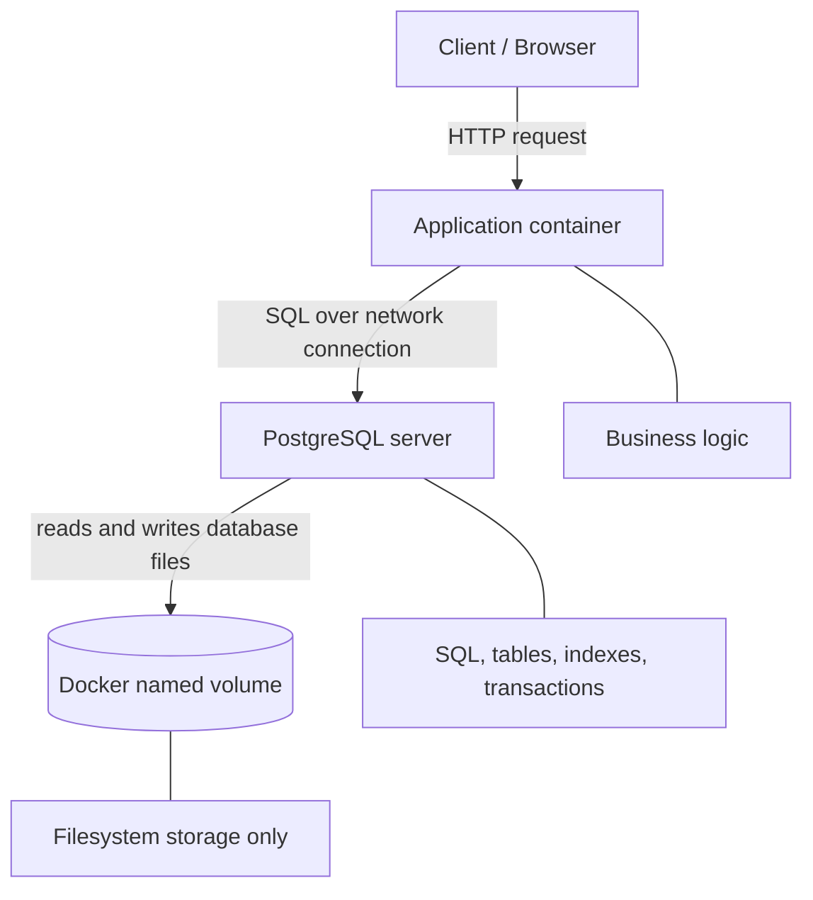
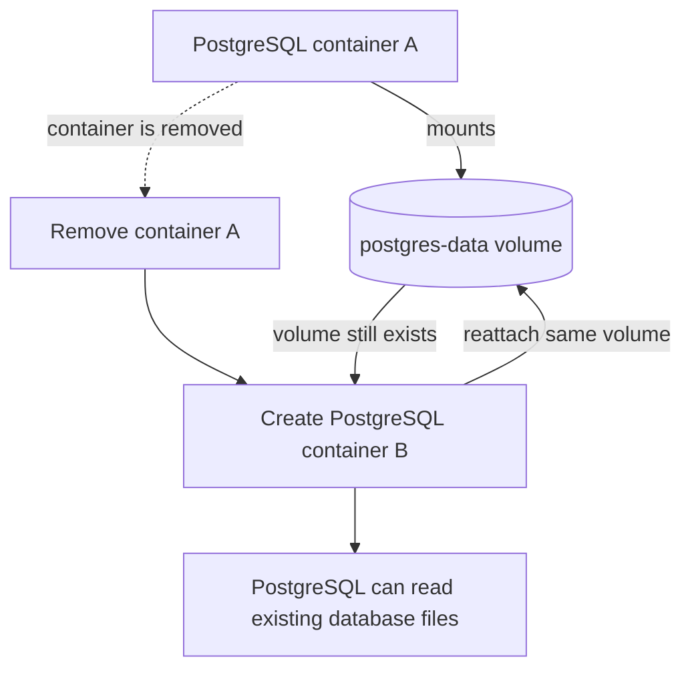
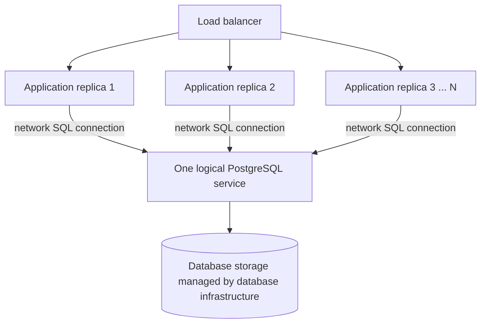
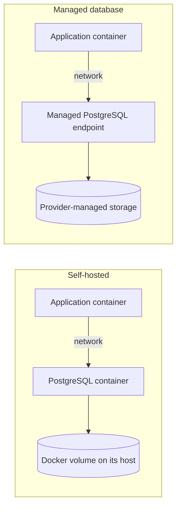

# Lesson 102 — Volumes: Database and Storage Mental Model

These Mermaid diagrams are editable source diagrams for revision. They distinguish database responsibilities from storage, explain volume lifecycle, and place storage in a distributed deployment.

## 1. Database vs. volume

**Read it as:** the application contains business logic, PostgreSQL understands and manages the database, and the volume provides filesystem storage for PostgreSQL's files. The volume itself does not understand SQL or tables.

## 2. Container replacement

The container can be replaced while the named volume remains. This only demonstrates persistence across container lifecycle; it is not a backup or a guarantee against host or storage failure. PostgreSQL should be stopped and managed safely when replacing a database container, and its data directory must be compatible with the PostgreSQL version and configuration.

## 3. Distributed application with a database service

Application replicas connect to the database service; they do not each own separate authoritative database copies. The database service's storage may be a Docker volume in a self-hosted deployment or provider-managed storage in a managed database service.

## 4. Self-hosted vs. managed PostgreSQL

A local Docker volume generally belongs to a particular Docker host. It does not automatically replicate to another host or provide failover. Managed database offerings typically abstract the underlying storage operations, but backup, retention, recovery objectives, and availability guarantees still need to be understood.

## Core mental model

- **Database engine:** interprets and manages structured data.
- **Database files:** represent persisted database state.
- **Volume:** filesystem storage that can outlive a container.
- **Database service:** the network-accessible endpoint that applications use.
- **Backup / replication / failover:** separate capabilities that must be designed and verified.
