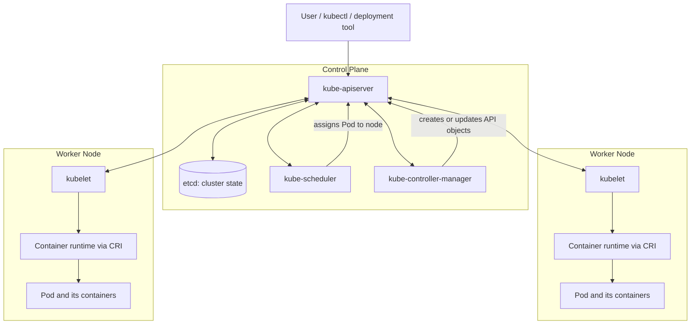
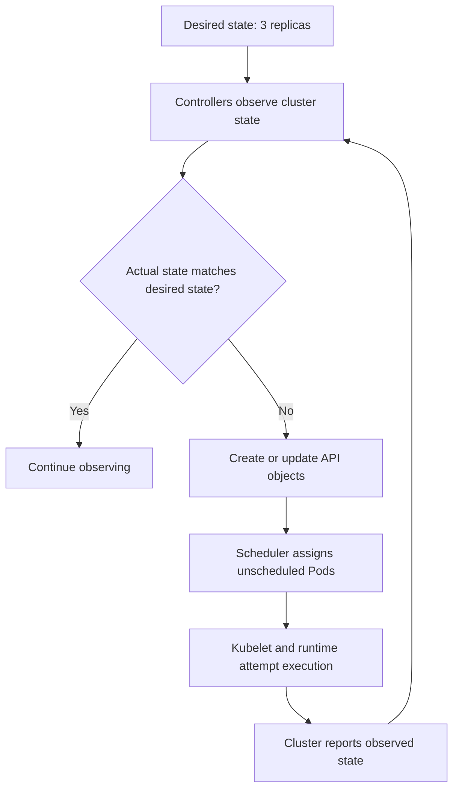
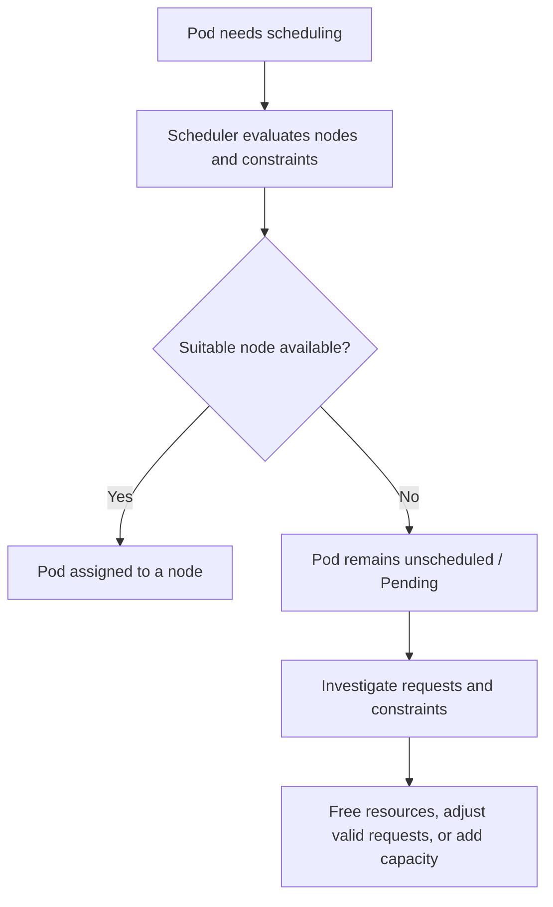

# Lesson 105 — Kubernetes Architecture Diagram

## Cluster Components

This diagram is conceptual. Kubernetes components communicate through API interactions and watches; the flow is asynchronous rather than a single linear function call.

## Desired-State Reconciliation

Reconciliation repeatedly attempts to reduce the difference between desired and actual state. It cannot guarantee convergence when constraints or failures prevent progress.

## When Capacity Is Insufficient

A Pending Pod caused by insufficient scheduling capacity is different from a container that starts and later exceeds its memory limit.
