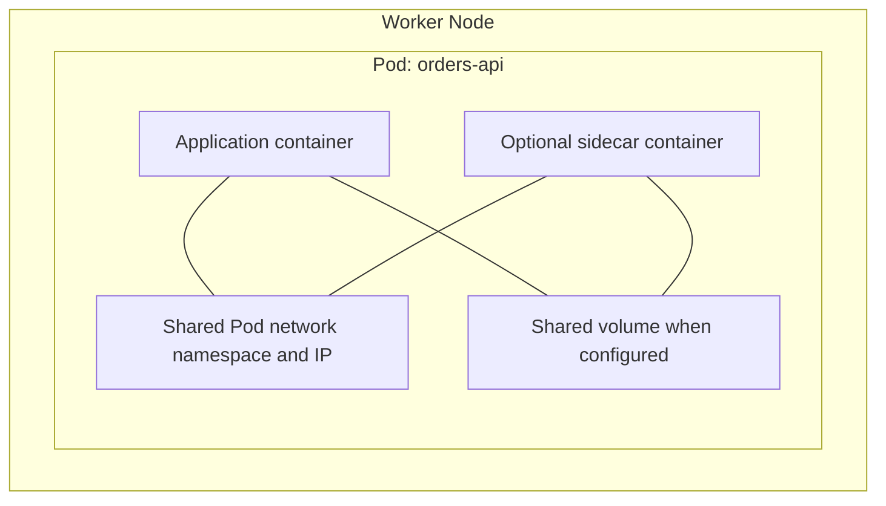
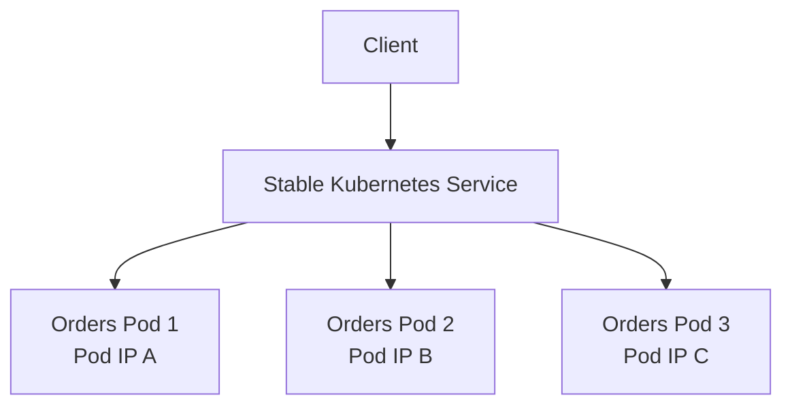
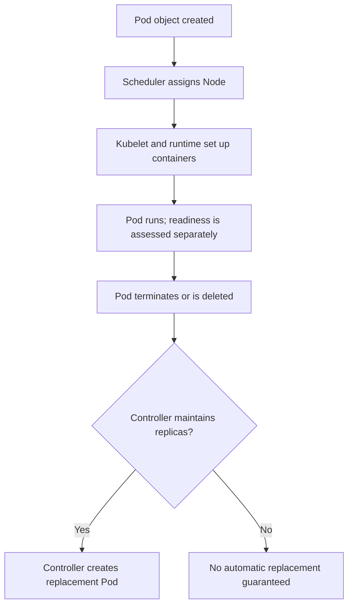

# Lesson 106 — Kubernetes Pods Diagrams

## Node, Pod, and Containers

A Pod is scheduled as one unit on a Node. Containers share its network namespace; they share files only through configured volumes.

## Pod IPs and Service

The Service selects eligible Pods and provides a stable access point while individual Pod IPs may change.

## Simplified Pod Lifecycle

A replacement is a new Pod object and may have a different IP address or Node.
