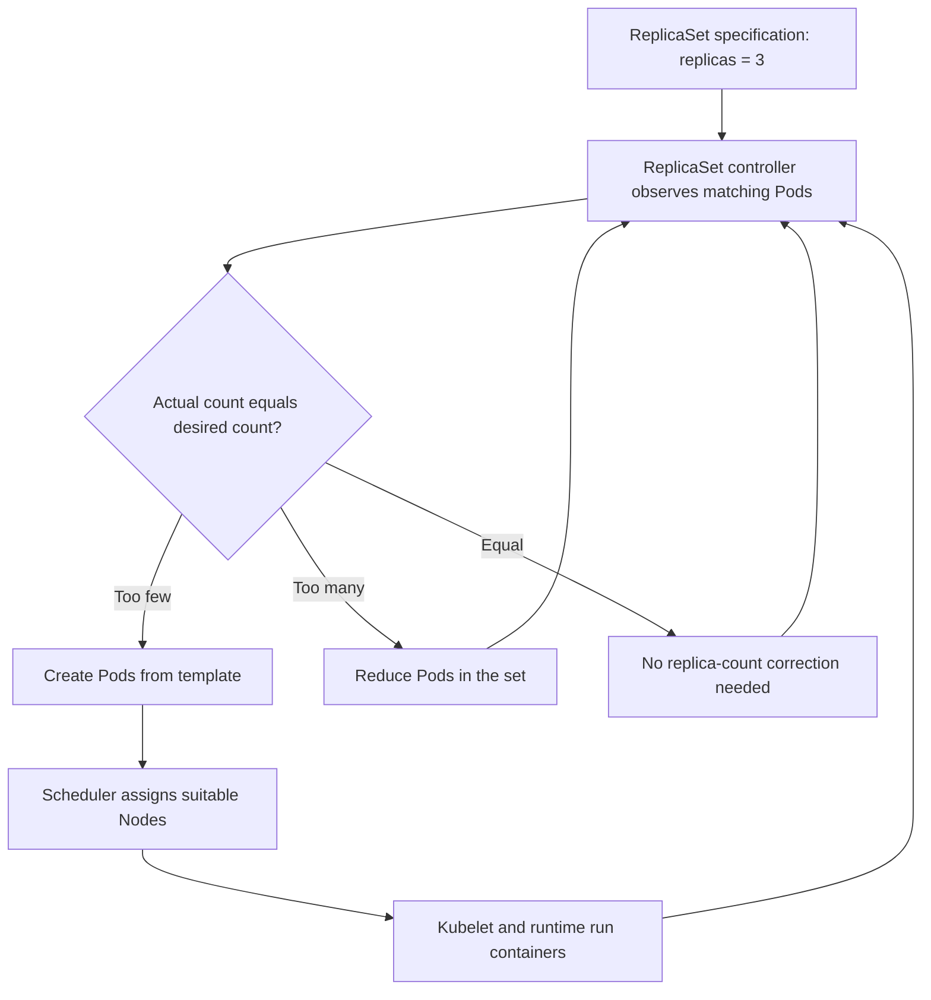
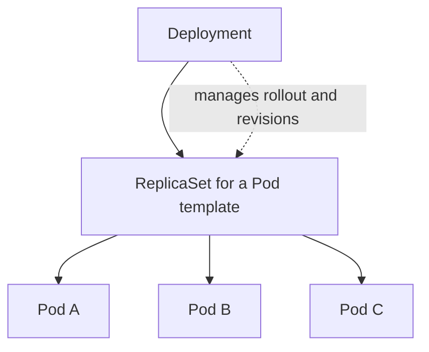
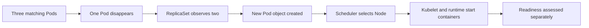

# Lesson 107 — ReplicaSets Diagrams

## Desired State and Reconciliation

Reconciliation repeats over time. Creating a Pod object does not guarantee that it will be scheduled or become Ready.

## Deployment, ReplicaSet, and Pods

A Deployment manages ReplicaSets to provide rollout and rollback behavior. A ReplicaSet maintains the desired count of Pods for its template.

## Pod Replacement

The replacement is a new Pod object and may have a different IP address or Node.
