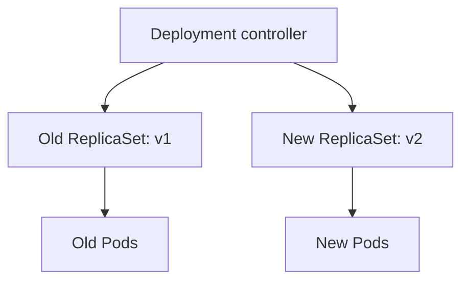
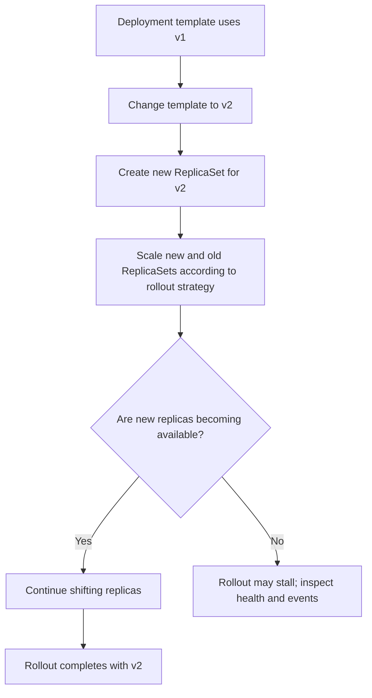
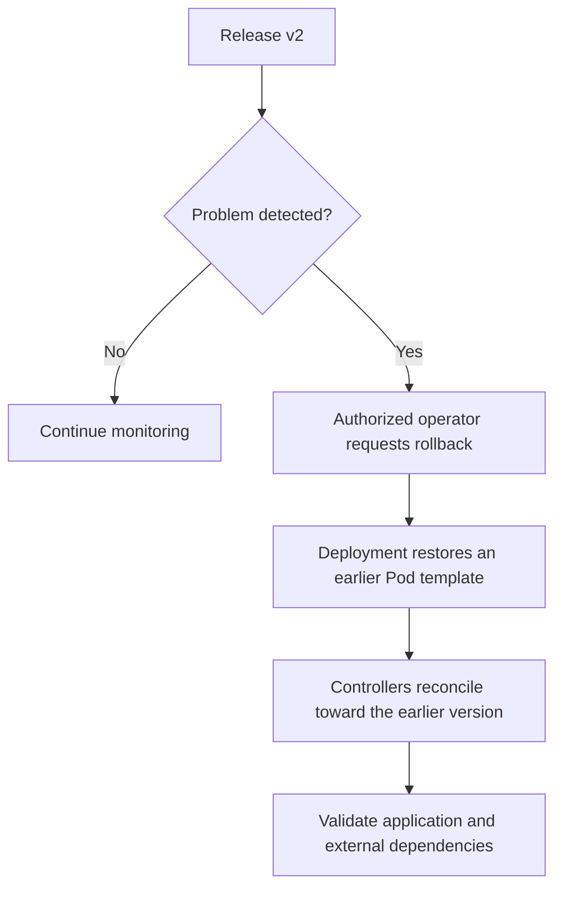

# Lesson 108 — Deployments Diagrams

## Ownership hierarchy

The Deployment coordinates ReplicaSets; each ReplicaSet maintains its own Pods.

## Rolling update concept

## Rollback concept

Rollback restores a Pod template, not database state or external side effects.
